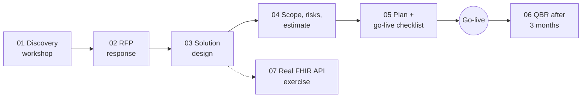

# Implementation Discovery Kit — before the build and after go-live

> **Built as a portfolio case, not a real engagement.**
> Medivane, Northbridge Health, their hospitals, people, products and all numbers are invented. The only real system used is the public HAPI FHIR R4 test server, with synthetic data. Nothing here is medical or legal advice; every point on UK GDPR, medical devices and clinical safety is an assumption to check with legal and clinical safety teams.

My other portfolio projects show how I build automations. This one shows the other half of an implementation role: the work **before the build** (discovery, RFP, solution design, scope, risks, estimate, plan) and **after go-live** (a 3-month business review with real KPI calculations).

## The scenario

- **Medivane** (fictional vendor) sells an AI symptom assessment and triage product for adults, used through a REST API and a web console for nurses.
- **Northbridge Health** (fictional) runs 5 hospitals in England and wants the product in its patient app and on its nurse-led advice line.
- The kit follows one implementation from the first workshop to the 3-month review, written from the vendor's implementation specialist's side.



## If you have 10 minutes

1. The **QBR one-pager** ([06, part A](docs/06_qbr_month3.md#part-a--the-one-page-review)): results, what went wrong, what I recommend.
2. The **RFP answers** ([02](docs/02_rfp_response.md)): how I answer when the honest answer is "it depends".
3. The **FHIR exercise** ([07](docs/07_fhir_api_exercise.md#1213-two-things-i-did-not-expect)): two things the real server did that I did not expect, and what they mean for the integration.

## What is in the kit, and why each document exists

| # | Document | What it is | Why an implementation team needs it |
|---|---|---|---|
| 01 | [Discovery workshop pack](docs/01_discovery_workshop.md) | 90-minute agenda, 25 questions in 6 groups, workshop notes, 10 decisions, 10 actions with owners | Most late projects were late from week 1: a question nobody asked. The pack makes sure the slow items (safety case, DPIA, app agency capacity) surface on day one |
| 02 | [RFP response](docs/02_rfp_response.md) | 15 hospital questions on integration, SSO, UK hosting, accessibility, support and timeline | Each answer starts with **Yes / Partly / Depends / No**. Where the answer depends on the hospital, it says what, instead of promising |
| 03 | [Solution design](docs/03_solution_design.md) | Architecture and sequence diagrams (Mermaid), data flow, authentication, webhooks, who owns what, failure modes | So both sides agree what they build before anyone writes code, and so IG can start the DPIA |
| 04 | [Scope, risks and estimate](docs/04_scope_risks_estimate.md) | In/out of scope, 10-risk register, three-point estimate in person-days with one assumption per line | The estimate shows that two thirds of the work sits with the hospital and its app agency, which changes how the plan is managed |
| 05 | [Implementation plan](docs/05_implementation_plan.md) | 6 phases over 24 weeks, owners, dependencies, 7 milestones, 18-item go-live checklist, hypercare exit criteria | A go-live decision based on evidence, not on "we think it's fine" |
| 06 | [QBR after 3 months](docs/06_qbr_month3.md) | 1-page review, 5 KPIs with definitions, what works, what does not, recommendations, one expansion lead for sales | Retention: show value with numbers the client can check, admit what went wrong, and pass growth signals to the right team |
| 07 | [FHIR API exercise](docs/07_fhir_api_exercise.md) | Real calls to the public HAPI FHIR R4 server: create, read, search, update with versions, 4 error cases, and 2 surprises found while re-testing (duplicates refused, cached search results) | FHIR is the likely standard for phase 2 (writing outcomes to the EPR). The responses shown are real |
| — | [JAK_TO_DZIALA.md](JAK_TO_DZIALA.md) | My own learning notes in Polish, plus 8 interview questions with answers | |

## Key numbers (all fictional, all calculated in code)

| | |
|---|---|
| Effort estimate | 143.3 person-days expected (Medivane 47.7, Northbridge incl. app agency 95.7); range 102–202 |
| Timeline | 20 weeks kickoff → go-live, 4 weeks hypercare |
| Top risk | Clinical safety case not signed in time (score 15 of 25) |
| QBR, month 3 | Advice-line call length 10.8 min vs 14.0 baseline; app completion 68.7% → 81.0%; nurse agreement 92.4% |
| What went wrong | Week-6 webhook incident (hospital certificate change): 29 of 56 red-flag alerts late to the hospital. Patients still saw "call 999" at once, by design |
| Real API | HAPI FHIR R4: statuses 200, 201, 400, 404, 409 and 412 seen and explained; the collection re-run end to end |

## Files

```
docs/                         the 7 documents above
data/
  qbr_weekly_usage.csv        fictional usage, 13 weeks x 2 hospitals x 2 channels
  qbr_kpi_summary.csv         KPI results written by scripts/qbr_kpis.py
  effort_estimate.csv         23 estimate lines with assumptions
  risk_register.csv           10 risks
scripts/
  make_qbr_data.py            recreates the fictional dataset (fixed seed)
  qbr_kpis.py                 calculates the 5 KPIs
  estimate.py                 totals the estimate
api-exercise/
  fhir_exercise.postman_collection.json   import into Postman or Hoppscotch
  responses/                  real responses from the HAPI FHIR server
```

Rerun every number (Python 3, standard library only):

```bash
python3 scripts/qbr_kpis.py
python3 scripts/estimate.py
```

## Honest limits

- **Not a real engagement.** No real hospital, vendor or patient. The workshop notes are written to be realistic, not taken from a meeting.
- **The QBR data is generated**, with two incidents built in on purpose to have something to review. It shows how I would read and present the numbers, not real product results.
- **Regulation is simplified.** Controller/processor roles, medical device status, clinical safety standards and accessibility rules are written as assumptions for legal and clinical teams to check.
- **The FHIR exercise used a public test server** with no authentication. A hospital endpoint would have OAuth, profiles and validation rules I did not test.
- I do not write production code. The three Python scripts are short calculations, kept so every number can be checked.

## Related portfolio projects

- [pharma-implementation-case](https://github.com/kubabiros595-png/pharma-implementation-case) — discovery to handover for an n8n triage workflow, tested
- [onboarding-tracker](https://github.com/kubabiros595-png/onboarding-tracker) — B2B onboarding plans, risk flags and checked AI drafts in n8n
