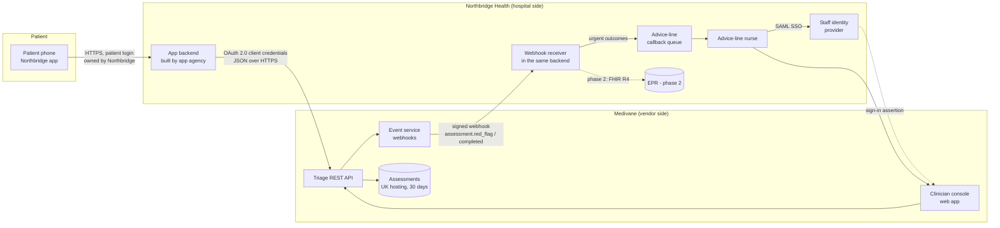
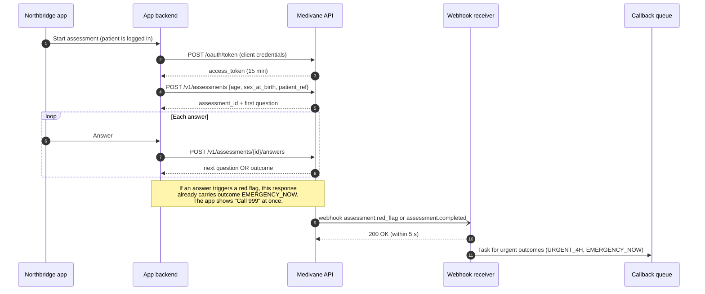

# 03 — Solution design

> **Fictional case.** Medivane's API, endpoints and event names are invented for this portfolio case. Data protection points are assumptions to be checked with legal. Not medical or legal advice.

## 1. The picture



**In one sentence:** the patient app talks only to Northbridge's own backend; the backend talks to Medivane; Medivane tells Northbridge about finished and urgent assessments by webhook; nurses use Medivane's web console with their normal hospital sign-in.

## 2. Who owns what

| Piece | Owner | Notes |
|---|---|---|
| Patient app screens | Northbridge (app agency) | Draws question and outcome screens from the JSON we send |
| Patient login and identity | Northbridge | Medivane never sees the patient's login |
| App backend (calls the API, holds secrets) | Northbridge (app agency) | Creates the pseudonymous patient reference |
| Webhook receiver | Northbridge | Checks signatures, ignores duplicates, answers within 5 seconds |
| Advice-line callback queue | Northbridge | Gets a task for every urgent or red-flag outcome from the app |
| Staff identity provider and SSO set-up on the hospital side | Northbridge IT | SAML 2.0 |
| Triage API, clinical logic, question content | Medivane | Versioned; changes announced 30 days ahead |
| Clinician console | Medivane | Used by advice-line nurses during calls |
| Webhook sending, retries, alert emails | Medivane | 6 retries over about an hour |
| Hosting, backups, security of stored data | Medivane | UK only (fictional) |
| Deployment clinical safety case | Northbridge Clinical Safety Officer | Uses Medivane's manufacturer safety case as input |
| Manufacturer clinical safety case | Medivane | |
| DPIA | Northbridge IG lead | Medivane provides input |

## 3. Patient app flow



**Why the red flag comes back in the API response and not only by webhook:** a webhook can be late (see the week-6 incident in the [QBR](06_qbr_month3.md)). The patient's screen must never wait for it. The webhook exists so the hospital can follow up, not so the patient gets the warning.

## 4. Advice-line flow

1. The nurse answers the call and opens the Medivane clinician console (already signed in through SSO).
2. The nurse asks the questions the console shows and types the answers.
3. The console shows the suggested urgency level and a short reasoning summary.
4. The nurse accepts it or **changes it, with a reason** (decision D7). Both the suggestion and the final level are stored.
5. The nurse gives the advice and records the outcome in the advice-line task list as today. (Phase 2 would copy it to the EPR automatically.)

## 5. Data flow

| Data item | From | To | Stored where | How long |
|---|---|---|---|---|
| Patient login | Patient | Northbridge app backend | Northbridge | Northbridge policy |
| Pseudonymous patient reference | App backend | Medivane API | Medivane | 30 days |
| Age, sex at birth | App backend or nurse | Medivane API | Medivane | 30 days |
| Answers to questions | Patient or nurse | Medivane API | Medivane | 30 days |
| Outcome, reasoning summary | Medivane | App backend, console, webhook | Medivane + Northbridge | 30 days at Medivane; Northbridge keeps its own record |
| Nurse's final level and reason | Nurse | Medivane console | Medivane | 30 days |
| Staff name and email (from SSO) | Identity provider | Medivane console | Medivane | While the account is active |

**Not sent to Medivane:** names, NHS numbers, addresses, phone numbers, free-text notes from the advice-line task list.

**Assumption to check with legal:** Northbridge is the controller and Medivane is a processor; the age and symptom answers are health data (special category under UK GDPR) even without a name, because the pseudonymous reference can be linked back by Northbridge. The DPIA must cover this.

## 6. Authentication

| Connection | Method | Detail |
|---|---|---|
| App backend → Medivane API | OAuth 2.0 client credentials | Separate client per environment and per channel; 15-minute tokens; secret stored in the backend's secret store, never in the app |
| Medivane → webhook receiver | HMAC-SHA256 signature | Header `Medivane-Signature: t=<timestamp>, v1=<signature>`; receiver rejects anything older than 5 minutes |
| Nurse → clinician console | SAML 2.0 SSO | Accounts created on first sign-in; access removed by disabling the user in the identity provider |
| Patient → app | Northbridge's own login | Not part of this project |

## 7. Webhooks

| Event | When | What the receiver does |
|---|---|---|
| `assessment.red_flag` | An answer triggers EMERGENCY_NOW | Creates a task in the callback queue marked "follow up"; never used to tell the patient |
| `assessment.completed` | Any outcome is reached | Saves the outcome; for URGENT_4H creates a callback task |
| `assessment.abandoned` | No answer for 30 minutes | Counts it for the drop-off report; no patient contact |

Example payload (fictional):

```json
{
  "event_id": "evt_01HZX3K9",
  "type": "assessment.red_flag",
  "created_at": "2027-03-04T10:15:22Z",
  "assessment_id": "asm_7Q2M",
  "patient_ref": "nbh-p-5f1c",
  "channel": "patient_app",
  "outcome": "EMERGENCY_NOW",
  "pathway": "chest_pain"
}
```

Receiver rules: check the signature first, answer `200` fast and do the work afterwards, store `event_id` and skip duplicates, alert someone if more than 1% of deliveries fail in a day.

## 8. Failure modes we designed for

| What fails | What the patient or nurse sees | Who is alerted |
|---|---|---|
| Medivane API down | App shows the advice-line number and 999; nurses switch to the paper protocol | Medivane on-call; status page; Northbridge integration lead |
| Webhook receiver down | Nothing changes for the patient (outcome already on screen) | Medivane retries for an hour, then emails Northbridge on-call |
| SSO down | Nurses cannot open the console; paper protocol | Northbridge service desk |
| Patient is under 16 or the symptom is pregnancy-related | Exclusion screen with where to go instead | Nobody; counted in reports |

## 9. What changes in phase 2 (not built in phase 1)

- Write completed assessments to the EPR through the integration engine as FHIR R4 resources. The hands-on exercise in [07_fhir_api_exercise.md](07_fhir_api_exercise.md) shows the basic calls this would use.
- Roll out to St Aldric's, Kelsey Vale and Marston Quay.
- Automatic user provisioning if SCIM becomes available.
